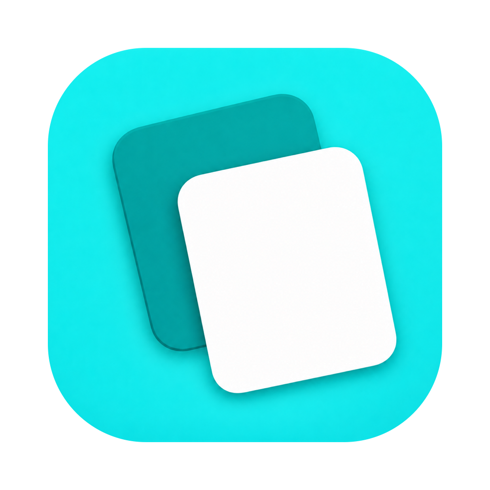
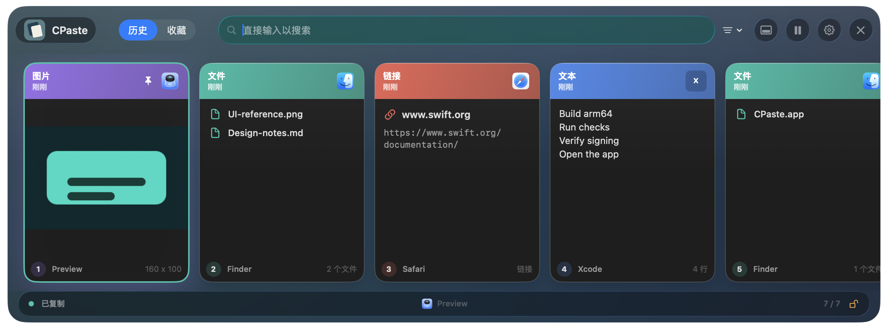

# CPaste

CPaste is a local, Apple Silicon native clipboard history app for macOS. It uses an original horizontal visual timeline with source-app badges, instant search, pinned items, keyboard navigation, drag out, preview, and quick paste. The interface supports English and Simplified Chinese.





## Download

Download the latest Apple Silicon build from [GitHub Releases](https://github.com/cjustsing/cpaste/releases/latest). CPaste requires macOS 13 or later.

The current release is signed ad hoc and is not Apple-notarized. On first launch, macOS may require you to right-click `CPaste.app`, choose **Open**, and confirm. You can verify the download with the SHA-256 checksum published alongside the release asset.

## Build

```sh
swift build -c release --arch arm64
./scripts/build_app.sh
```

Run the lightweight core checks:

```sh
swift run CPasteCoreChecks
```

Check native text editing with an isolated AppKit field editor:

```sh
./scripts/check_app_input_full.sh
```

Check clipboard delivery, history safeguards, login items, and resource handling with isolated effects:

```sh
./scripts/check_paste_delivery.sh
./scripts/check_history_capacity.sh
./scripts/check_capture_shutdown.sh
./scripts/check_login_item.sh
./scripts/check_visual_resources.sh
```

Run the full quality gate:

```sh
./scripts/quality_gate.sh
```

The app bundle is created at:

```text
build/CPaste.app
```

The production 1024 px icon, complete iconset, and packaged `.icns` are stored under:

```text
Resources/AppIcon
```

The approved solid double-card artwork and design record are in [docs/design/app-icon](docs/design/app-icon/README.md). Regenerate the production assets directly from that original with `swift scripts/generate_app_icon.swift`; the script cleans the outer edge with an antialiased mask and generates all icon sizes without repainting the artwork.

Verify the architecture:

```sh
file build/CPaste.app/Contents/MacOS/CPaste
lipo -archs build/CPaste.app/Contents/MacOS/CPaste
```

## Run

```sh
open build/CPaste.app
```

The app lives in the menu bar. Press `Command+Shift+V` to open the history panel.

Enable **Settings > General > Launch at Login** to start CPaste in the menu bar when you sign in to macOS. The switch reflects the system login-item state; if approval is needed, use **Open System Settings** to allow CPaste. Turning it off persists across app restarts.

Inspect the installed app's login item without starting clipboard capture:

```sh
/Applications/CPaste.app/Contents/MacOS/CPaste --login-item status
```

Use `--login-item enable` or `--login-item disable` to change it explicitly. The command prints the app path, version, and actual system status as JSON; a pending approval returns exit code 2.

CPaste follows the macOS language by default. You can also choose `System`, `简体中文`, or `English` in Settings > General > Interface Language; the change takes effect immediately.

User manuals:

- [简体中文使用说明书](docs/CPaste-使用说明书.md)
- [English User Guide](docs/CPaste-User-Guide.md)

Generate current UI screenshots:

```sh
swift build -c release --arch arm64
mkdir -p docs/screenshots/timeline-refactor
.build/arm64-apple-macosx/release/CPaste --snapshot-dir docs/screenshots/timeline-refactor
```

Open an isolated 8 MB text fixture to check search focus and long-text preview responsiveness:

```sh
.build/arm64-apple-macosx/release/CPaste --snapshot-preview 09-large-text
```

Use `--snapshot-preview 10-capacity-confirmation` for a disposable 60-item fixture with three pinned items, then open Settings to check capacity confirmation. It does not record or write the system clipboard.

Liquid Glass screenshots require macOS 26 or later. Screen Recording permission must be available to the process that runs the snapshot command because native glass is captured from an onscreen WindowServer composition.

For corner and shadow checks, set `CPASTE_SNAPSHOT_SHADOWS=1` to include the native window shadow at its original capture size. `CPASTE_SNAPSHOT_SCALE=1` or `2` places the snapshot window on a connected display with that backing scale (otherwise it uses the default display). Use `CPASTE_SNAPSHOT_THEME=standard` to compare the standard theme. In an interactive preview, closing the panel simulates a new presentation while keeping the fixture window visible, so reopening state can be checked without the global hotkey.

For local UI smoke checks without touching your real history:

```sh
CPASTE_STORAGE_DIR="$(mktemp -d /tmp/cpaste-demo.XXXXXX)" build/CPaste.app/Contents/MacOS/CPaste --demo
```

## Permissions

CPaste can copy available history content back to the system clipboard. Missing images or files are checked before replacing the current clipboard. To paste automatically into the previous app, macOS requires Accessibility permission:

System Settings -> Privacy & Security -> Accessibility -> enable CPaste.

Automatic paste is cancelled if the target app exits, focus changes to another app, the clipboard changes, or permission becomes unavailable while delivery is pending. If the clipboard has changed, CPaste keeps its new contents and reports the cancellation; otherwise the copied content remains available for manual paste. Reopening CPaste or starting another copy/paste invalidates an earlier pending delivery.

## Storage

History is stored locally under:

```text
~/Library/Application Support/CPaste
```

Text entries larger than 64 KiB keep their full UTF-8 body in separate local files, so ordinary history updates do not rewrite large text inside the index. Existing history migrates automatically without truncating content or changing pins, timestamps, source metadata, or attachments. Routine saves and full-text searches run in the background; quitting waits for pending saves.

Clipboard capture takes a native pasteboard snapshot, then performs image validation, conversion, hashing, and attachment staging on a bounded background pipeline. Valid PNG data keeps its original bytes. Normal quit waits for accepted captures to reach history before saving. Image thumbnails share a two-operation decoding budget, and source-app icon lookups run in the background with bounded caching.

CPaste retains a valid history backup and preserves damaged files before recovery. If it cannot safely preserve the original history, it blocks replacement writes and shows a storage warning. Keep the entire storage directory together when backing it up, including the text and attachment files referenced by the indexes.

After repairing a storage problem, open **Settings > Privacy > History Storage > Retry Saving**. Accepted content that failed to save remains available for retry while the app is running. If another program has independently changed known disk history, CPaste preserves a complete local recovery copy and keeps the external history intact. The settings page provides shortcuts to the data folder and saved recovery copy.

Clipboard entries marked as concealed, transient, auto-generated, or as coming from a supported password manager are ignored. The storage and blob directories are restricted to the current user, but history contents are not encrypted at the application level.

Resuming capture skips content copied while paused, including pause/resume cycles shorter than a polling interval. Lowering history capacity requires confirmation when it would remove unpinned items; cancelling preserves the current capacity and history.

No network sync or upload is implemented.

To verify a legacy history migration on a disposable copy:

```sh
swift run CPasteCoreChecks --migration-source "/path/to/legacy/CPaste"
```

This check compares every history item and binary attachment and does not initialize or write a store in the source directory.

The on-disk format, recovery behavior, and background search contract are documented in [Storage and recovery](docs/Storage-and-Recovery.md).

## Support CPaste

If CPaste is useful to you, you can voluntarily support its independent development. Support is entirely optional and does not unlock features or affect app usage or future updates.

如果 CPaste 帮到了你，可以自愿支持这个独立开发的个人项目。赞赏不会解锁任何功能，也不会影响软件使用或后续更新。

<details>
<summary>View Alipay and WeChat Pay codes / 查看支付宝与微信收款码</summary>

Only the QR modules are published; personal avatars and display names are intentionally omitted. / 仓库仅展示二维码图形，个人头像与昵称已移除。

| Alipay / 支付宝 | WeChat Pay / 微信支付 |
| --- | --- |
|  |  |

</details>

## License

CPaste is an independently developed personal project owned by `cjustsing`.

Licensed under the Apache License, Version 2.0. See [LICENSE](LICENSE) and [NOTICE](NOTICE).
